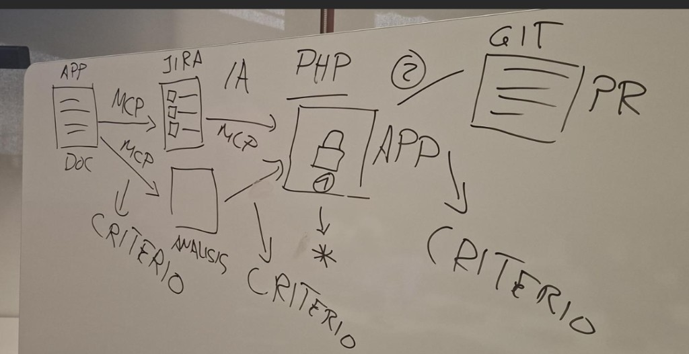

# Paso 1: Definir el proyecto con `CLAUDE.md`

## Punto de partida

Queremos desarrollar una aplicación de **lista de tareas** con:

- PHP + Symfony + Doctrine (backend, API REST)
- Angular (frontend)
- Tests

La carpeta del proyecto estaba vacía.

## El flujo de la pizarra

| Elemento | Significado |
|----------|-------------|
| **APP / DOC** | Documentación funcional de la aplicación. |
| **MCP → JIRA** | A partir del documento, la IA crea las tareas en el gestor. En este proyecto usamos **GitHub Issues** en lugar de Jira (MCP de GitHub o CLI `gh`). |
| **ANÁLISIS** | Las historias se analizan y se completan con criterios de aceptación. |
| **IA → MCP → PHP** | La IA lee el issue de GitHub e implementa en el proyecto. |
| **Candado (1)** | El fichero que **define el proyecto**: stack, estructura, dominio y convenciones. Es lo que fija el contexto de la IA. |
| **GIT / PR (2)** | El resultado termina en una rama y una Pull Request. |
| **CRITERIO** | Cada fase tiene su propio criterio de aceptación; no se avanza sin cumplirlo. |

## Qué hicimos

Creamos un `CLAUDE.md` en la raíz con:

- Descripción del proyecto y stack.
- Estructura de carpetas (backend por capas: `Domain`, `Application`, `Infrastructure`, `UI`).
- Modelo de dominio (`Task`) y reglas de negocio.
- Endpoints de la API REST.
- Comandos de backend y frontend.
- Convenciones de código y tests.
- Flujo de trabajo de la pizarra.
- Lista de tareas inicial y "qué no hacer".

## Lo aprendido

- `CLAUDE.md` es el fichero que Claude Code carga automáticamente en cada sesión: es la **memoria del proyecto**.
- Debe contener lo que la IA no puede deducir del código: decisiones de arquitectura, reglas de negocio, comandos y límites.
- Con la carpeta vacía, el `CLAUDE.md` actúa como **diseño previo**: la IA construye a partir de él.
- Las decisiones no especificadas (versiones, base de datos, arquitectura) hay que dejarlas explícitas para poder revisarlas.
