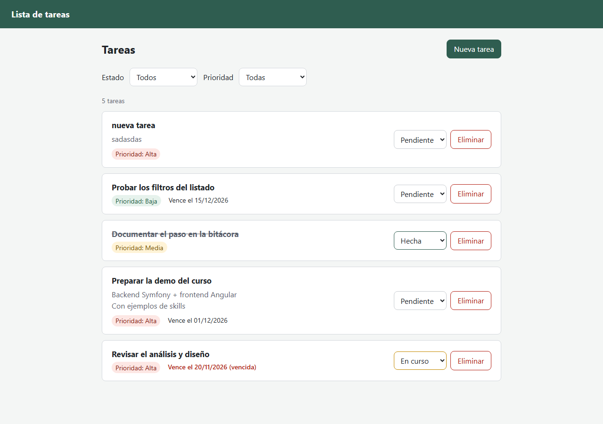

# Paso 10: Aplicación 0.1 (backend y frontend)

## Objetivo

Construir la primera versión completa de la lista de tareas de `AGENTS.md`:

- API REST en Symfony con tests.
- SPA en Angular con listado con filtros, alta, edición y cambio de estado.

Todo en la rama `feature/app-0.1`, para abrir un PR al final.

## Qué hicimos

1. **Entorno** (no había PHP ni Composer):
   - `winget install PHP.PHP.8.3` y activación en `php.ini` de `pdo_sqlite`, `sqlite3`, `intl`, `mbstring`, `openssl`, `curl`, `zip` y `fileinfo`.
   - Composer 2 instalado con su instalador, verificando la firma.
   - **SQLite en desarrollo y en tests** en lugar de PostgreSQL: sin Docker ni servidor de base de datos.
2. **Backend Symfony 7.4** en `backend/`:
   - Generado en `backend-tmp/` y movido, porque `composer create-project` exige una carpeta vacía.
   - Paquetes: ORM pack, validator, serializer, `nelmio/cors-bundle`, PHPUnit, PHPStan y PHP-CS-Fixer.
3. **Dominio** (`src/Domain/Task/`):
   - Entidad `Task` con las reglas de negocio.
   - Value objects `TaskId`, `TaskTitle` y `TaskDueDate`, y enums `TaskStatus` y `TaskPriority`.
   - Cinco excepciones de dominio y la interfaz `TaskRepository`.
4. **Infraestructura**:
   - Mapeo XML `Task.orm.xml` y tipo DBAL `task_id`.
   - `DoctrineTaskRepository`, que genera UUID v7 en `nextIdentity()`.
   - Migración inicial con índices por estado, prioridad y fecha de creación.
5. **Aplicación**: un command o query con su handler (`__invoke`) por caso de uso (crear, listar, obtener, actualizar, cambiar estado y eliminar), que devuelve `TaskResponse` o `TaskPageResponse`.
6. **UI HTTP**:
   - Seis controladores invocables con DTOs de entrada validados (`#[MapRequestPayload]`, `#[MapQueryString]`), con mensajes en español.
   - Un `ExceptionListener` que da a todos los errores el formato `{ "error": { "code", "message", "details" } }`.
7. **Tests**: 81 tests (Unit, Integration y Functional) construidos con `TaskMother` y un `InMemoryTaskRepository`. PHPUnit, PHPStan nivel 8 y PHP-CS-Fixer en verde.
8. **Frontend Angular 22** en `frontend/`:
   - Generado con `--zoneless --skip-tests`, sin `tsconfig.spec.json` ni script `test`.
   - ESLint (angular-eslint, que exige `OnPush` y prohíbe `any`), Prettier y `proxy.conf.json` hacia `http://127.0.0.1:8000`.
9. **Funcionalidades del frontend**:
   - Modelos tipados y `TaskService`.
   - Un interceptor que convierte los errores de la API en `ApiRequestError`.
   - Páginas de listado (filtros, paginación, cambio de estado y borrado), alta y edición.
   - Pipes de etiquetas en español.
10. **Verificación de extremo a extremo**:
    - Un script PHP lanzó todas las peticiones de la API, directamente y a través del proxy de `npm start`.
    - Capturas de la app con Edge en modo headless.
11. **Documentación**:
    - `README.md` con el arranque.
    - `AGENTS.md`: stack (SQLite, Angular 22) y casillas marcadas.
    - `docs/analisis-diseño.md`: preguntas abiertas resueltas.

### Decisiones tomadas al implementar

| Pregunta abierta | Decisión |
|---|---|
| Paginación | `page=1`, `limit=20`, máximo `100` |
| Orden | `createdAt` descendente, después `id` |
| `pending → done` | Permitida; solo se prohíbe `done → pending` |
| Mismo estado | No hace nada ni toca `updatedAt` |
| `dueDate` pasada | Permitida; el frontend la marca como vencida |

### Problemas encontrados

| Problema | Causa | Solución |
|---|---|---|
| `Cannot generate lazy ghost: class is final` al calentar la caché de prod | Doctrine genera proxies que extienden la entidad | `Task` no es `final` (documentado en la clase) |
| Autowiring de `TaskRepository` roto | Se excluyó `src/Domain/` de los servicios | Alias explícito a `DoctrineTaskRepository` en `services.yaml` |
| `phpstan/extension-installer` bloqueado | `allow-plugins` de Composer | Incluir los `.neon` de las extensiones a mano |
| `curl` en PowerShell quitaba las comillas del JSON | Paso de argumentos de PowerShell 5 | Script PHP para las pruebas manuales |
| Todos los desplegables de estado mostraban "Pendiente" | `[value]` en el `<select>` se aplica antes de que `@for` cree las opciones | `[selected]` en cada `<option>` |
| Fechas un día antes (15/12 → 14/12) | `DatePipe` lee `YYYY-MM-DD` como fecha local y se formateaba en `UTC` | Quitar la zona `UTC` del pipe |
| Huecos enormes en el formulario | `flex: 1 1 12rem` en `.field` dentro de un contenedor en columna | Aplicar el `flex` solo dentro de `.field-row` |

## Lo aprendido

- Build, lint y tests en verde no garantizan que la interfaz se vea bien. Las tres últimas filas de la tabla solo aparecieron al mirar una captura, y Edge en modo headless (`--screenshot`) basta para verlo sin abrir el navegador.
- Mantener el dominio sin dependencias del framework tiene peajes concretos: la entidad no es `final`, hace falta un tipo DBAL para el value object del `id` y un alias para el repositorio. A cambio, las reglas se testean sin base de datos.
- SQLite en desarrollo y en tests elimina toda la infraestructura del curso. Como el esquema es portable, pasar a PostgreSQL solo exige cambiar `DATABASE_URL`.
- En Windows, PowerShell 5 no acepta `&&` y destroza el JSON que se pasa a `curl`. Para pruebas manuales de una API es más fiable un script en el propio lenguaje del backend.
- Resolver las preguntas abiertas del análisis al implementar y anotarlas en el documento evita que la decisión se quede solo en el código.
