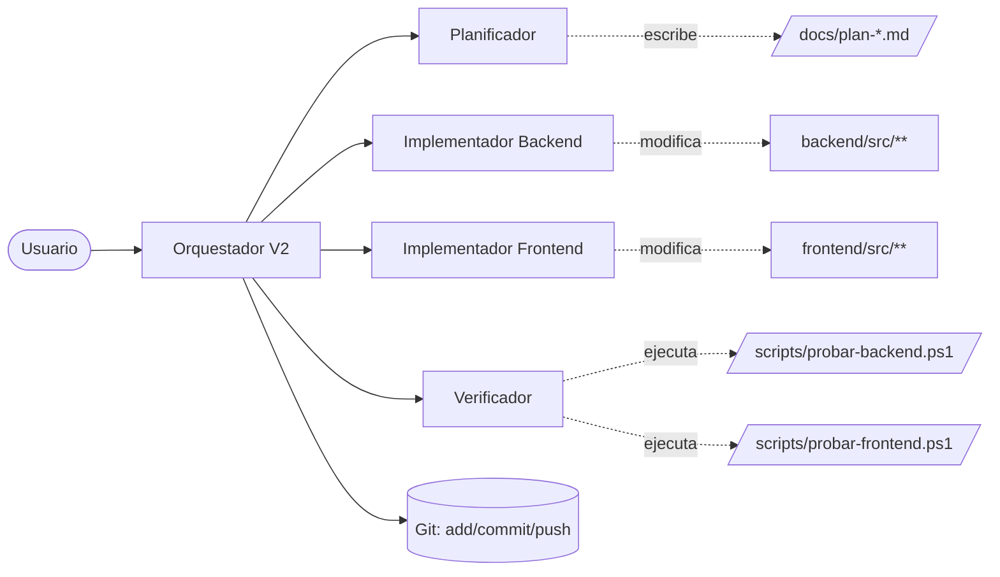
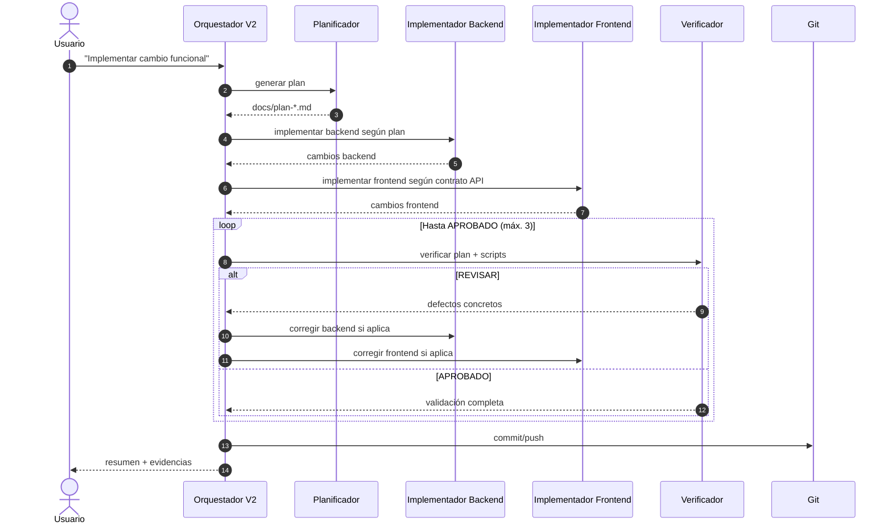

# Arquitectura de Agentes V2 — tstcln-reservas

Esta versión V2 adapta la arquitectura de agentes al proyecto real (`Symfony + Angular`) y reemplaza referencias de `.NET` por el flujo técnico actual.

La versión anterior se mantiene intacta en [docs/ARQUITECTURA-AGENTES.md](docs/ARQUITECTURA-AGENTES.md).

---

## 1. Objetivo

Coordinar cambios funcionales de reservas de salas con un flujo repetible de:

1. planificación,
2. implementación por capa,
3. verificación automática,
4. commit con trazabilidad.

El sistema debe respetar las fronteras del dominio (`sala`, `reserva`, `franja horaria`, `ocupación`, `asistentes`, `estado`) y las capas ya definidas en el repositorio.

---

## 2. Mapa de agentes (V2)

El orquestador sigue siendo el único agente que decide cierre, commit y publicación.

---

## 3. Roles y responsabilidades

| Rol | Responsabilidad principal | Puede editar código | Resultado esperado |
|---|---|---|---|
| Orquestador V2 | Coordina flujo completo, controla iteraciones y decide commit | No (salvo ajustes menores de integración) | Resumen final + commit coherente |
| Planificador | Convierte la petición en plan ejecutable por capas | Solo `docs/plan-*.md` | Plan con criterios de aceptación |
| Implementador Backend | Aplica cambios en Symfony/dominio/persistencia/API | Sí (`backend/`) | Backend funcional + pruebas backend en verde |
| Implementador Frontend | Aplica cambios en Angular/modelos/servicios/componentes | Sí (`frontend/`) | UI/servicios adaptados + pruebas frontend en verde |
| Verificador | Ejecuta validaciones automáticas y reporta hallazgos | No | Veredicto `APROBADO` o `REVISAR` con evidencias |

Principio de separación: quien verifica no corrige y quien coordina no valida su propio trabajo.

---

## 4. Flujo operativo

---

## 5. Verificación y criterio de salida

El verificador usa estos comandos del proyecto:

1. `./scripts/probar-backend.ps1`
2. `./scripts/probar-frontend.ps1`

Si se modifican entidades persistidas o mapeos:

1. validar esquema/mapeos Doctrine,
2. comprobar compatibilidad del contrato JSON consumido por Angular.

Veredicto:

- `APROBADO`: pruebas verdes y sin regresiones funcionales detectadas.
- `REVISAR`: incluye fallos reproducibles, archivo afectado e impacto funcional.

---

## 6. Modo de trabajo por capas

Para evitar arquitectura paralela, el orden recomendado en cambios full-stack es:

1. Dominio y reglas (`backend/src/Reservas/`, `backend/src/Salas/Dominio/`)
2. Aplicación/infraestructura backend (`backend/src/Salas/Aplicacion/`, `backend/src/Salas/Infraestructura/`, controladores, repositorios)
3. Contrato HTTP JSON
4. Modelos/servicios Angular (`frontend/src/app/modelos/`, `frontend/src/app/servicios/`)
5. Componentes Angular (`frontend/src/app/componentes/`)
6. Verificación automática

---

## 7. Política de iteraciones y bloqueo

Límite de reintentos recomendado: 3 ciclos de `REVISAR -> corregir -> verificar`.

Si tras 3 ciclos no hay `APROBADO`:

1. no se hace commit automático,
2. se entrega informe de bloqueo,
3. se listan pendientes concretos para decisión manual.

---

## 8. Entregables mínimos de una ejecución

1. Plan en `docs/plan-*.md`.
2. Cambios de código en backend/frontend según alcance.
3. Resultado de verificación backend/frontend.
4. Resumen final con:
   - objetivo implementado,
   - ficheros tocados,
   - pruebas ejecutadas,
   - riesgos o tareas pendientes.

---

## 9. Diferencias clave frente a la versión anterior

1. Se elimina dependencia conceptual de `.NET`/`dotnet build`.
2. Se incorporan scripts de validación reales del repositorio.
3. Se explicita ejecución por capas Symfony/Angular.
4. Se alinea terminología con el dominio de reservas.
