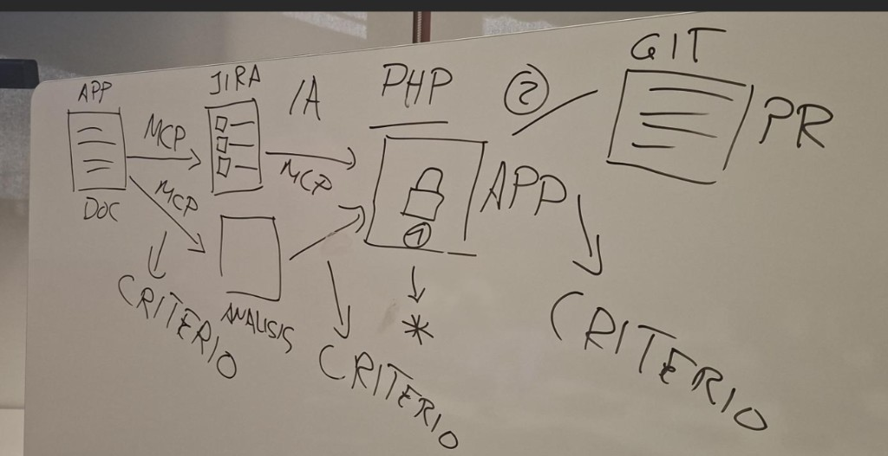

# Bitácora del curso

Registro de los pasos dados y lo aprendido en cada uno. Se mantiene con la skill `bitacora`.

## Estado actual

- **Último paso**: 8. Documentos de referencia y cierre de sesión (handoff)
- **Siguiente paso**: crear el proyecto Symfony 7 en `backend/` (primera tarea pendiente de `AGENTS.md`); ver los comandos en el paso 5
- **Bloqueos**:
  - PHP 8.3, Composer y Angular CLI no están instalados (solo Node 24)
  - Sin CLI `gh` ni MCP de GitHub el agente no puede crear issues ni PR (sí puede hacer push)
- **Decisiones pendientes**:
  - Qué hacer con los documentos de referencia de otros proyectos (`ARQUITECTURA-AGENTES-V2.md`, `skills-orquestacion-v2.md`, `analisis-diseño.md`): adaptarlos a este proyecto o moverlos a `docs/referencias/`
  - Redactar la documentación funcional en `docs/funcional/` para generar los issues de GitHub
- **Remoto**: https://github.com/jsanchezc31/demo_agentes (`origin/main`)
- **Cómo retomar**: en un chat nuevo, `/bitacora retoma el proyecto`

## Pasos

| # | Paso | Documento |
|---|------|-----------|
| 1 | Definir el proyecto con `CLAUDE.md` (Claude Code) | [01-definicion-proyecto-claude-md.md](01-definicion-proyecto-claude-md.md) |
| 2 | Llevar la definición a Cursor: `AGENTS.md` + reglas `.mdc` | [02-migracion-a-cursor.md](02-migracion-a-cursor.md) |
| 3 | Crear el repositorio Git en local | [03-repositorio-git-local.md](03-repositorio-git-local.md) |
| 4 | Skill para los mensajes de commit | [04-skill-mensajes-commit.md](04-skill-mensajes-commit.md) |
| 5 | Crear la estructura de carpetas | [05-estructura-de-carpetas.md](05-estructura-de-carpetas.md) |
| 6 | Skill para la bitácora y retomar en un chat nuevo | [06-skill-bitacora.md](06-skill-bitacora.md) |
| 7 | Commit con la skill y repositorio remoto en GitHub | [07-repositorio-remoto-github.md](07-repositorio-remoto-github.md) |
| 8 | Documentos de referencia y cierre de sesión (handoff) | [08-documentos-referencia-y-cierre.md](08-documentos-referencia-y-cierre.md) |

## Estructura de `docs/`

- `NN-titulo.md`: un documento por paso, numerado en orden.
- `img/`: imágenes de apoyo (pizarra, capturas, diagramas).
- `funcional/`: documentación funcional del producto que alimenta los issues de GitHub.
- `ARQUITECTURA-AGENTES-V2.md`, `skills-orquestacion-v2.md`, `analisis-diseño.md`: **referencia de otros proyectos**, no describen este. La definición de este proyecto está en `AGENTS.md`.
