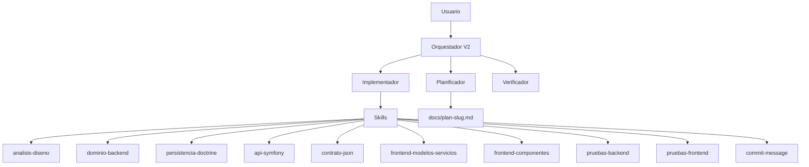
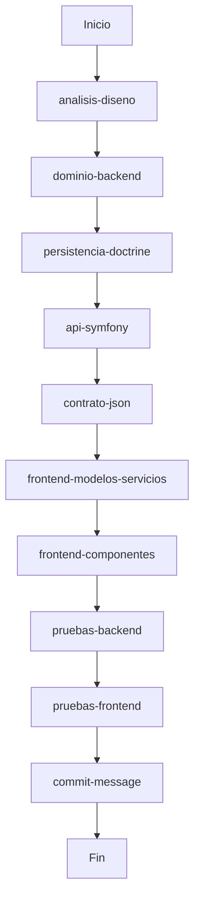
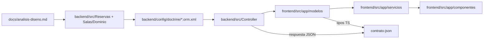
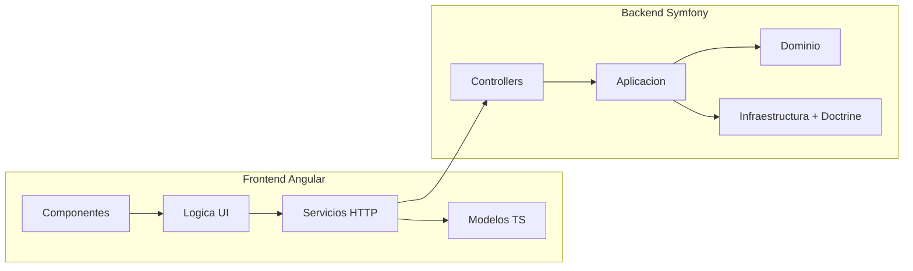
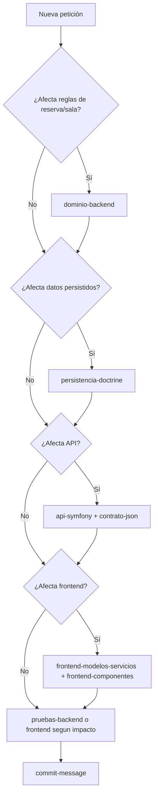

# Orquestación de Skills V2 — tstcln-reservas

Esta versión V2 adapta la orquestación de skills al stack real del repositorio: backend Symfony/PHP con Doctrine y frontend Angular/TypeScript.

La versión anterior se mantiene intacta en [docs/skills-orquestacion.md](docs/skills-orquestacion.md).

---

## 0. Agentes vs. Skills

Los agentes coordinan el flujo. Los skills describen cómo ejecutar cada tramo técnico.

---

## 1. Catálogo de skills V2

| Skill | Carpeta/ámbito | Responsabilidad |
|---|---|---|
| analisis-diseno | docs/ | Define alcance, reglas de negocio, criterios de aceptación y capas afectadas |
| dominio-backend | backend/src/Reservas, backend/src/Salas/Dominio | Implementa reglas de dominio y servicios puros de negocio |
| persistencia-doctrine | backend/config/doctrine, backend/src/*/Infraestructura | Ajusta entidades persistidas, mapeos XML, repositorios y acceso a datos |
| api-symfony | backend/src/Controller, backend/config/services.yaml | Implementa endpoints, códigos HTTP y serialización JSON coherente |
| contrato-json | backend + frontend | Alinea nombres camelCase, campos obligatorios y errores de API |
| frontend-modelos-servicios | frontend/src/app/modelos, frontend/src/app/servicios | Actualiza modelos TypeScript y llamadas HTTP relativas (/reservas, /salas, /ocupacion) |
| frontend-componentes | frontend/src/app/componentes, frontend/src/app/logica | Implementa UI y lógica de presentación con componentes standalone |
| pruebas-backend | backend/tests, scripts/probar-backend.ps1 | Crea/ajusta pruebas PHPUnit y valida backend |
| pruebas-frontend | frontend/src, scripts/probar-frontend.ps1 | Crea/ajusta pruebas Vitest y valida frontend |
| actualizar-documentacion | docs/, README.md | Sincroniza documentación funcional y técnica con el código real |
| commit-message | repositorio completo | Genera mensaje de commit claro y trazable al objetivo funcional |

---

## 2. Flujo de ejecución recomendado

Nota: si el alcance es solo backend o solo frontend, se ejecuta el subconjunto mínimo necesario, manteniendo siempre el paso contrato-json cuando exista intercambio API.

---

## 3. Dependencias entre skills

Regla: ningún skill inventa contratos o reglas que no estén en analisis-diseno o en el dominio existente.

---

## 4. Arquitectura por capas que debe respetar cada skill

Regla de dirección: la lógica de reserva, solapamiento y ocupación vive en dominio/aplicación, no en controladores ni en componentes de UI.

---

## 5. Validaciones por skill

| Skill | Verificación mínima |
|---|---|
| dominio-backend | Reglas de negocio cubiertas por pruebas de servicio/dominio |
| persistencia-doctrine | Mapeos consistentes y sin ruptura de esquema esperado |
| api-symfony | Códigos HTTP correctos: 400 inválido, 404 inexistente, 409 conflicto de dominio |
| contrato-json | Campos camelCase y estructura de error compatible con frontend |
| frontend-modelos-servicios | Endpoints relativos y tipado consistente |
| frontend-componentes | Render y comportamiento validados con Vitest |
| pruebas-backend | scripts/probar-backend.ps1 en verde |
| pruebas-frontend | scripts/probar-frontend.ps1 en verde |

---

## 6. Cuándo usar cada skill

---

## 7. Convenciones de salida por skill

| Skill | Entregable esperado |
|---|---|
| analisis-diseno | Documento breve con alcance, reglas, endpoints y criterios de aceptación |
| dominio-backend | Cambios en clases de dominio/servicios sin mezclar detalles HTTP |
| persistencia-doctrine | Ajustes en mapeos XML y repositorios con impacto de persistencia claro |
| api-symfony | Endpoints y respuestas JSON alineadas al dominio |
| contrato-json | Tabla de mapeo backend-frontend de campos y errores |
| frontend-modelos-servicios | Tipos y servicios HTTP actualizados |
| frontend-componentes | UI funcional y consistente con el contrato API |
| pruebas-backend | Pruebas nuevas/actualizadas y ejecución documentada |
| pruebas-frontend | Pruebas nuevas/actualizadas y ejecución documentada |
| commit-message | Mensaje final con alcance funcional y capas tocadas |

---

## 8. Diferencias clave frente a la versión anterior

1. Sustituye capas y artefactos C# por capas Symfony/Angular.
2. Cambia EF Core y Program.cs por Doctrine XML, servicios Symfony y scripts del repositorio.
3. Introduce skill explicito de contrato-json para asegurar compatibilidad backend-frontend.
4. Alinea toda la orquestación al dominio de reservas de salas.
